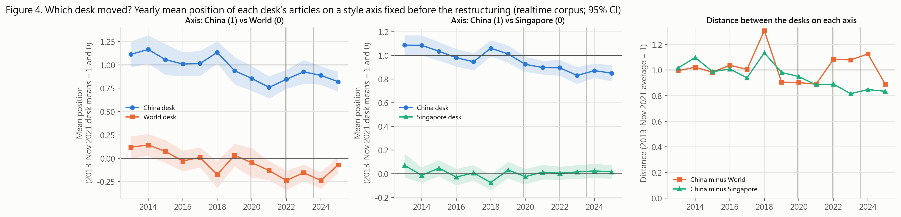
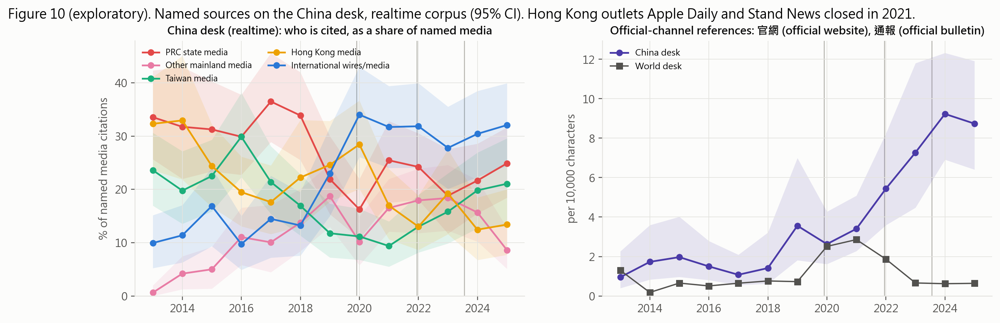

# Tracing China in Lianhe Zaobao, 2006–2025: results summary

Every number below is produced by the scripts in `src/` (see [README.md](README.md)); the CSV that
holds each number is named in brackets. The paper ([Tracing_China_in_Lianhe_Zaobao.pdf](Tracing_China_in_Lianhe_Zaobao.pdf)) presents the same results in
full prose. Figure numbers match the paper.

---

## 1. Findings in brief

1. **No change in tone at the December 2021 restructuring.** None of the three hypotheses
   (divergence from the World desk, convergence on the Singapore desk, a more assertive stance)
   is supported as a change at the restructuring [summary_did_fdr.csv, summary_who_moved_fdr.csv,
   summary_convergence_fdr.csv].

2. **The China desk hedges a third less than the World desk — and has for twenty years.**
   China/World hedge rate ratios: 0.60 (desk full texts 2006–12), 0.68 (desk leads 2016–25), 0.58
   (realtime 2013–25), all q < .001 [summary_longrun_gaps.csv]. 可能 (*keneng*, "possibly") alone is 84% of the
   realtime gap and 79% of the legacy gap [markers_gap_decomposition.csv].

3. **The hedging gap is not only a matter of topic.** With NMF topic fixed effects the realtime ratio is
   0.67–0.78 and the legacy ratio 0.66; restricted to topics both desks cover, 0.67 and 0.66. Topic
   composition explains a fifth to a half of the (log) gap [topic_controlled_gaps.csv].

4. **The China desk is not an outlier.** It hedges *more* than the Singapore desk
   (1.16–2.14×), attributes far more (1.45–2.51×), and uses obligation words *less* than the World
   desk (0.63–0.68 in desk text; 0.69–0.77 within topic). Boosters are the one category pointing the
   other way (realtime 1.26×, q = .08; 1.26–1.47× within topic, not in legacy text).

5. **Divergence (Q1): not supported.** Realtime China–World style AUC rose from 0.75 (2013–21) to
   0.82 (2022–25), p = .026, q = .21. On a style axis fixed before the break, both desks shifted the
   same way (China −0.14, World −0.18 of the pre-2021 gap) and the distance between them did not
   change (jump +0.13, 95% CI −0.14 to 0.40) [who_moved.csv, who_moved_gap.csv].

6. **Convergence (Q2): gradual, not at the restructuring.** On the China–Singapore axis the China
   desk moved toward Singapore (−0.14) while the Singapore desk stayed (+0.01); the distance fell to
   0.85 of its pre-2021 level, starting around 2019–2020, with no jump at December 2021 (−0.06, 95% CI
   −0.20 to 0.08). The China desk's position fell on both axes, so its style became less distinctive
   overall.

7. **Sourcing changed (exploratory).** References to official channels (官網 *guanwang*, "official website";
   通報 *tongbao*, "official bulletin") on the China desk rose from 1.0 per 10,000 characters (2013) to 3.4 (2021)
   and 9.2 (2024); the World desk stayed at 0.2–2.9. China/World DiD at Dec 2021: 3.33 (2.09–5.30),
   the largest of all eleven break years. Robust to dropping COVID articles (3.66), dropping 2020–22
   (5.10) and year-level inference (4.09, p = .022) [sources_official_did_placebo.csv,
   sources_official_robustness.csv]. The share of named media citations going to PRC state media
   *fell* (33% in 2013–18 → 21–22% from 2019); international wires rose (13% → 30–31%)
   [sources_shares.csv].

---

## 2. Data

**Archive.** All URLs under Zaobao's article grammars were harvested from the Internet Archive CDX
index and reduced to one row per canonical article: **618,626 articles**, of which 240,745 desk and
342,754 realtime articles were published 2006–2025 [data/raw/cdx_index.csv]. The publication date is
read from the URL; 19% of modern desk articles were first captured in a later year.

| Corpus | Years | Desks | Text used | Sample |
|---|---|---|---|---|
| Desk | 2006–12 | China, World, Singapore, SE Asia | full text | 8,352 |
| Desk | 2016–25 | China, World, Singapore, SE Asia | leads (first two paragraphs) | 12,000 |
| Realtime | 2013–25 | China, World, Singapore | full text | 7,800 |

The desk archive has no articles for 2013–2015 (197 URLs; only daily index pages were captured),
and 58.6% of sampled 2016–25 desk pages are paywall teasers (70–80% each year 2016–2022)
[data_quality_summary.csv, paywall_truncation_share.csv]. Hence the realtime corpus is primary for
the modern era and desk articles are analysed through their leads.

**Sample.** Stratified by corpus × desk × publication year; 300 usable articles per desk stratum and
200 per realtime stratum, in seeded random order: **28,152 articles**, 19,901 with complete text.
Exclusions: fetch failures 63, print-edition stubs 319, < 50 characters 1,755, duplicates 6
[exclusions.csv]. 105 boilerplate paragraphs removed [boilerplate_paragraphs_removed.csv]. Audit of 40
random extractions: [extraction_audit.md].

---

## 3. Methods

* **Tokenization.** OpenCC (to simplified) + jieba; only tokens containing a Chinese character.
* **Lexicon** [src/lexicon.py]: hedge, booster, obligation, permission, attribution (Palmer 2001;
  Hyland 1998), matched on whole tokens.
* **Rate ratio.** Poisson QMLE, log(tokens) offset, year FE, HC1 SEs; NB as sensitivity check.
* **Restructuring DiD.** `markers ~ desk + year + China×After(1 Dec 2021)`. Article-level and
  year-level (Welch on yearly log rate ratios) inference, both FDR-corrected. Placebo breaks on
  1 Dec of every year (realtime 2014–24, leads 2017–24).
* **Topic control.** NMF (K = 20, 40) on TF-IDF, fitted on all desks without labels; dominant topic
  as fixed effect.
* **Distinguishability.** L2 logistic regression, out-of-fold AUC (5-fold × 3), ≤150 articles per
  desk per cell, averaged over 10 random draws; style = 300 closed-class function words.
* **Which desk moved.** Classifier fitted on pre-Dec-2021 articles only; pre articles scored
  out-of-fold, post articles by the average of the same fold models (a refit on all pre data would
  inflate post scores ~12% and fake a divergence). ITS per desk with year-clustered SEs; ITS on the
  13 yearly desk distances.
* **Content similarity.** TF-IDF cosine, half-vs-half with a same-desk reference. (A cosine of
  4 marker-category rates is uninformative: attribution is 99% of the vector's squared length, so it
  is ≈0.999 even within one desk [cosine_diagnostic.csv].)
* **Distinctive words.** Weighted log-odds with informative Dirichlet prior (Monroe et al. 2008).
* **Multiple comparisons.** BH-FDR within families: F1 realtime DiD (5), F2 lead DiD (5), F3 AUC
  change (8), F4 who moved (6), F5 sources (11, exploratory).

---

## 4. Key tables

**Restructuring DiD, China vs World** [summary_did_fdr.csv]

| Category | Realtime, article level | Realtime, year level | Leads, article level | Leads, year level |
|---|---|---|---|---|
| Hedge | 0.91 [0.71, 1.17], q .60 | 0.88 [0.72, 1.08], q .48 | 0.83 [0.63, 1.09], q .29 | 0.79 [0.56, 1.12], q .21 |
| Booster | 0.62 [0.38, 1.02], q .15 | 0.81 [0.45, 1.46], q .64 | 0.61 [0.26, 1.43], q .32 | – |
| Obligation | 1.01 [0.72, 1.41], q .97 | 0.92 [0.60, 1.39], q .64 | 0.53 [0.33, 0.85], q .044 | 0.53 [0.26, 1.08], q .14 |
| Permission | 0.89 [0.64, 1.23], q .60 | 0.85 [0.32, 2.26], q .64 | 0.55 [0.32, 0.95], q .076 | 0.58 [0.35, 0.95], q .14 |
| Attribution | 0.92 [0.86, 0.98], q .056 | 0.90 [0.84, 0.97], q .068 | 1.00 [0.91, 1.11], q .94 | 1.02 [0.83, 1.24], q .86 |

Realtime attribution declines smoothly across placebo breaks (0.995 at 2014 → 0.92 at 2021 →
0.89 at 2023) and vanishes with topic FE (0.97 [0.90, 1.03]) [topic_controlled_did.csv]. Lead
obligation is not robust (year level q = .14; placebo estimates 0.43–1.02). Against the Singapore
desk, realtime obligation rose (1.53 [1.09, 2.15]); pooled controls 1.20 [0.90, 1.61] [markers_did.csv].

**Which desk moved** [summary_who_moved_fdr.csv]

| Axis | Desk | Shift | Drift/yr | Jump at Dec 2021 [95% CI] | q |
|---|---|---|---|---|---|
| China vs World | China | −0.14 | −0.036 | +0.09 [−0.05, 0.23] | .43 |
| | World | −0.18 | −0.024 | −0.02 [−0.16, 0.12] | .75 |
| | Distance | +0.04 | −0.014 | +0.13 [−0.14, 0.40] | .43 |
| China vs Singapore | China | −0.14 | −0.018 | −0.03 [−0.10, 0.04] | .43 |
| | Singapore | +0.01 | −0.003 | +0.03 [−0.03, 0.10] | .43 |
| | Distance | −0.15 | −0.014 | −0.06 [−0.20, 0.08] | .43 |

**Per-word notes** [markers_per_term.csv, markers_kwic.md]. The China/World ratio for 據 (*ju*, "according to") doubles after
2021 (1.36 → 2.72) only because the World desk's rate collapsed (27.0 → 9.9 per 10k words); the China
desk's own rate fell (36.7 → 26.8). 不得 (*bude*, "must not") tripled on the China desk (1.0 → 3.0 per 10k words), almost
always inside quoted rules and official statements, but in only 29 articles.

---

## 5. Figures

All figures are in `figures/`, numbered as in the paper: 1 archive coverage, 2 content similarity,
3 desk distinguishability (AUC), 4 which desk moved, 5 marker rates by desk, 6 yearly China/World
rate ratios, 7 placebo breaks, 8 per-word rate ratios, 9 distinctive words, 10 sources. Figure S1
(PCA of desk-year style averages) is a supplementary visual check.

---

## 6. Limitations

* Archive coverage: desk full texts 2016–23 are mostly paywall teasers; leads (about 60 words) are noisy.
* Genres differ; levels are never compared across corpora.
* The World desk has its own news shocks; one result (realtime obligation) depends on the control desk.
* Only four post-break years: low power for year-level tests; early trends and breaks are hard to separate.
* Topic models are coarse; the share of the gap they explain depends on K (19–53%).
* Source counts are substring counts of outlet names; 通報 can also be a verb ("to notify"); a hand-coded sample is needed.
* No design here identifies a cause.

## 7. Reproducibility

`py run_all.py 4` regenerates every table and figure from the downloaded HTML; all randomness is
seeded (`SEED = 20260407` in `src/config.py`).
